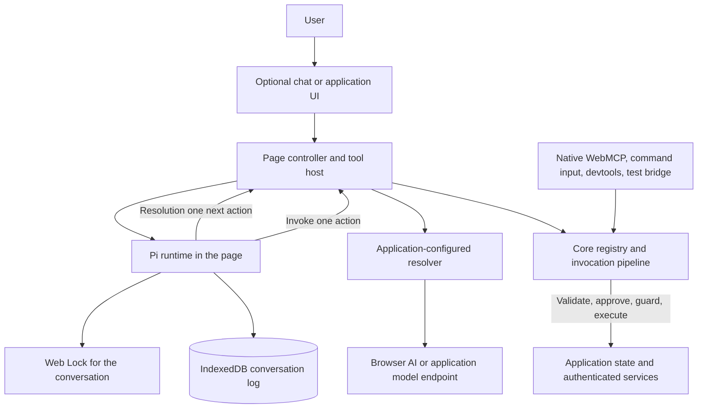
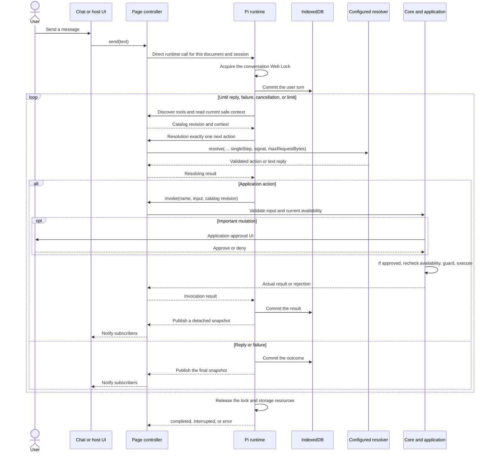
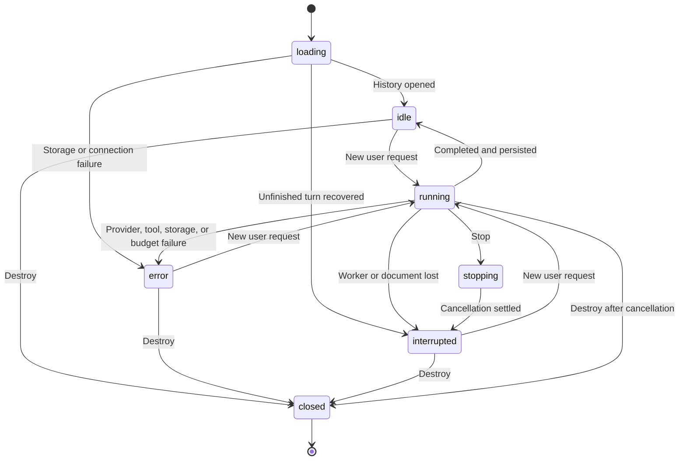

# Architecture

[Documentation index](./README.md) · [Integration](./integration.md) · [API reference](./api-reference.md)

## Components and ownership

The application owns tools, state, authorization, approvals, model configuration, and lifecycle. The kit supplies registration, validation, transport, persistence, and optional interfaces. A resolver proposes an action; only application code executes it.

| Surface           | Responsibility                                                                                    | Starts work on import?                                     |
| ----------------- | ------------------------------------------------------------------------------------------------- | ---------------------------------------------------------- |
| Core              | Definitions, registry, native adapter, invocation, resolvers, diagnostics                         | No automatic tool registration or inference                |
| `/pi`             | `createPiHarness`, current-context `createPiRuntime`, registry tool host, public controller types | No worker, storage, or model request                       |
| `/chat`           | Text-only transcript and controls bound to a supplied controller                                  | Only after defining, mounting, and configuring the element |
| Framework helpers | Register tools in a framework lifecycle                                                           | When the helper runs in its documented lifecycle           |

Core and chat do not load the Pi runtime. The distribution bundles Pi implementation dependencies, while `/chat` imports controller types only. A fake or application-owned controller can drive the same component. The page's default tool host uses the existing core registry; it does not create a second registry inside a worker.

## One conversational turn

The runtime never predicts the result of an unfinished action. After a successful action, it discovers tools again. An action that opens an editor can expose a save tool for the next round. A catalog change during resolution rejects the old action. Core also rechecks registration identity, schema, scope, and cancellation after approval and guards.

The standalone command input has a different contract: it can execute a validated sequence of up to five resolved steps. Pi always requests one next action and re-resolves from actual results. Heuristic fallback is available for ordinary commands; the conversational runtime requires an available resolver with `capabilities.conversation === true`.

## State and cancellation

Initialization can reject before a controller exists. `send()` reports its outcome as data; callers must inspect the returned status. `stop()` and `clear()` can reject on host or storage failures. Closing the popup only hides the view. Removing the element unsubscribes the view. Neither action destroys the controller.

Stop aborts resolution and pending approval. It cannot undo an action that already reached the application or server. A lost reply can leave the action's outcome unknown. The runtime does not automatically retry the turn. Heartbeats apply only to the connection and turn that initiated them; a late failure cannot cancel a later turn.

## Persistence and recovery

The session key contains `namespace`, `ownerId`, and `conversationId`. These values partition IndexedDB and the Web Lock. They are not authentication or protection from scripts on the same origin. The host must use the authenticated account identifier, replace the controller on account changes, and choose retention rules.

Each operation opens the bounded log, replays committed entries into Pi's reference store, and closes resources when finished. Writes reach IndexedDB before snapshots become visible. Web Locks prevent competing tabs or controllers from reading, clearing, or writing the same conversation during an active operation. A competing operation receives `conversation_busy` rather than stealing the lock.

On recovery, unfinished tasks are aborted before model or tool execution is enabled. History remains visible, and the interrupted marker persists. Recovery does not replay old actions. Browser storage can be cleared or evicted, and automatic compaction is disabled.

The page's `pagehide` handler stops work when the browser saves the document in the back/forward cache. The restored controller can accept a new user request. Ordinary document disposal destroys it.

## Deployment boundaries

Deploy the page and its bundled JavaScript through the application's normal workflow. Pi uses the page's IndexedDB and Web Locks. Existing PWA and dedicated inference workers are independent. Validate the production HTTPS origin and CSP with the consuming application.
