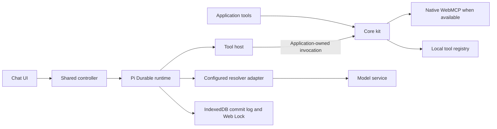

# Plan: WebMCP Kit, Pi Durable harness, chat UI, and Chrome extension

Date: 2026-10-17. Status: Phases 1–5 implemented and locally validated. See [implementation evidence](./webmcp-kit-first-deliverable-evidence.md). Implementation and local packaging were authorized in the chat. This document authorizes no publication or deployment.

## Confirmed direction

Ship three independently importable surfaces in the same `@vampaz/webmcp-kit` npm package:

1. **Core kit:** register and execute application tools, with native WebMCP integration and a registry for browsers without native support.
2. **Pi harness:** a headless conversation and tool execution loop built on Pi Durable, extracted from the demo.
3. **Chat UI:** an independent, configurable interface that consumes the harness. Developers configure it through code. It has no provider, model, endpoint, API key, or harness settings panel.

Build a Chrome extension later. The extension consumes these same components and initially signs users into their **WebMCP account** for hosted inference credits. A subsequent phase adds external provider login, including OpenAI where a supported authorization path exists.

All implementation belongs in `/Users/carlosrodrigues/works/web-mcp`. This document is the development plan in that repository. The existing sibling demo is a read-only reference for extraction, not a work destination or a required local dependency.

The first deliverable is the three package surfaces and a small in-repository demo, through Phase 5. The extension and WebMCP login form the second deliverable, Phases 6–7. External provider login is Phase 8.

Use local models served by **LM Studio** for interactive development and model integration tests. The current standalone WebMCP demo will adopt all three components later. Prepare its integration guide here, after validating the package locally; do not make that adoption a prerequisite for developing the kit.

## Repository ownership and verified baseline

The table and prerequisite notes in this section record the pre-implementation baseline. Phases 1–5 have since added the local lab, browser tests, Pi/chat exports, and invocation rechecks. Use the [developer documentation](../docs/README.md) for current contracts and the [implementation evidence](./webmcp-kit-first-deliverable-evidence.md) for completed checks. Phases 6–8 remain proposals.

All proposed files are inside Kit. Paths use these labels; commands run from Kit unless a step names Extension or Service.

| Label            | Root                                                         | Ownership                                                                                 |
| ---------------- | ------------------------------------------------------------ | ----------------------------------------------------------------------------------------- |
| Kit              | `/Users/carlosrodrigues/works/web-mcp`                       | Published components, tests, development plan, consumer docs, and all new applications    |
| Local demo       | `/Users/carlosrodrigues/works/web-mcp/apps/demo`             | Small Vite/TypeScript consumer and browser fixtures, using root development dependencies  |
| Extension        | `/Users/carlosrodrigues/works/web-mcp/apps/chrome-extension` | Future private application; excluded from the kit's npm tarball                           |
| Service          | `/Users/carlosrodrigues/works/web-mcp/apps/service`          | Future private account/inference application; excluded from the kit's npm tarball         |
| Legacy reference | `/Users/carlosrodrigues/works/web-mcp-demo`                  | Existing standalone demo and backend source; read-only during this work, later a consumer |

Inspected local commits: Kit `0f0bd3c56ff58c98a2459f98bc23eb8229c52715`; Legacy reference `05e64a454df9bb804b3631b934ad0cffb38b993c`. These identify the inspected checkouts, not the latest remote or production state. Recheck Kit and the relevant reference files before extraction. Reference links below identify evidence, not destinations for edits.

| Existing surface                         | Evidence and consequence                                                                                                                                                                                                                                                                                                                       |
| ---------------------------------------- | ---------------------------------------------------------------------------------------------------------------------------------------------------------------------------------------------------------------------------------------------------------------------------------------------------------------------------------------------- |
| Single npm package with multiple exports | [Kit package.json](/Users/carlosrodrigues/works/web-mcp/package.json) and [Vite entries](/Users/carlosrodrigues/works/web-mcp/vite.config.ts) already support subpath exports. Add entries instead of creating three separately versioned packages. The root currently has no npm `workspaces` field.                                          |
| Local development                        | Kit currently has no runnable demo or browser-test runner. Reuse its Vite, TypeScript, and Vitest tooling; add the small app and Playwright setup here.                                                                                                                                                                                        |
| Native and fallback registration         | [registry.ts](/Users/carlosrodrigues/works/web-mcp/packages/core/src/registry.ts), [native-adapter.ts](/Users/carlosrodrigues/works/web-mcp/packages/core/src/native-adapter.ts), and [support.ts](/Users/carlosrodrigues/works/web-mcp/packages/core/src/support.ts) already share application validation and execution. Reuse this boundary. |
| Pi runtime                               | [pi-assistant.ts](/Users/carlosrodrigues/works/web-mcp-demo/src/workers/pi-assistant.ts) runs Pi Durable in a service worker. [pi-connection.ts](/Users/carlosrodrigues/works/web-mcp-demo/src/utils/pi-connection.ts) handles page requests. The worker URL, pathname scope, and messages are demo-specific.                                  |
| Persistence and recovery                 | [pi-storage.ts](/Users/carlosrodrigues/works/web-mcp-demo/src/utils/pi-storage.ts) commits an IndexedDB log before applying state. A Web Lock serializes writers. Reopening cancels unfinished work without replaying page actions.                                                                                                            |
| Model bridge                             | [pi-resolver.ts](/Users/carlosrodrigues/works/web-mcp-demo/src/utils/pi-resolver.ts) adapts `ToolResolver`; [pi-model.ts](/Users/carlosrodrigues/works/web-mcp-demo/src/utils/pi-model.ts) adapts its output to Pi. Usage fields are placeholders, not measured token consumption.                                                             |
| UI coupling                              | [PiAssistant.vue](/Users/carlosrodrigues/works/web-mcp-demo/src/components/PiAssistant.vue) renders Pi-specific state and uses `--demo-*` styles. [DemoShell.vue](/Users/carlosrodrigues/works/web-mcp-demo/src/components/DemoShell.vue) gets the selected resolver through the existing command-input controls.                              |
| Accounts and hosted access               | [auth.ts](/Users/carlosrodrigues/works/web-mcp-demo/src/lib/auth.ts) supplies Better Auth. [session.ts](/Users/carlosrodrigues/works/web-mcp-demo/src/pages/api/webmcp/session.ts) exchanges project publishable keys for short-lived service sessions. This is not extension user login.                                                      |
| Usage accounting                         | [access-validation.ts](/Users/carlosrodrigues/works/web-mcp-demo/src/lib/paid-services/access-validation.ts) records access events; [schema.ts](/Users/carlosrodrigues/works/web-mcp-demo/src/db/schema.ts) has project policies and keys. Neither provides a user credit ledger.                                                              |

Existing resolving documents contain historical checkboxes. Reconcile their relevant work against code; do not use those checkboxes as proof of implemented token accounting.

One prerequisite needs hardening: [invocation.ts](/Users/carlosrodrigues/works/web-mcp/packages/core/src/invocation.ts) checks scope before approval and guards afterward, but does not explicitly recheck scope or abort state immediately before execution. Passing a signal to an application callback does not enforce cancellation when that callback ignores it. Step 1.2 must close this gap before the extracted harness promises to cancel pending actions safely.

## Architecture decisions

### 0. Repository layout and local development

Keep the published library under `packages/`. Add `packages/pi` and `packages/chat` alongside core. Keep `apps/demo`, `apps/chrome-extension`, `apps/service`, tests, and `temp-docs` outside the npm package contents. Retain one version for the three published imports.

The local demo uses Vue 3, TypeScript, and Vite, following the user's implementation update. It uses root development dependencies and a dedicated Vite configuration. Do not add another application framework or a workspace orchestrator. The isolated package consumer also uses Vite + Vue; the earlier Astro fixture requirement is superseded. Extension and Service get private manifests, lockfiles, and scoped scripts when their phases begin. Their dependencies must not enter the library's public dependency graph. Keep application output directories separate from root `dist`.

Provide three small example modes, each importing only what it demonstrates:

| Mode    | What a developer can verify                                                                                                                                                                       |
| ------- | ------------------------------------------------------------------------------------------------------------------------------------------------------------------------------------------------- |
| Core    | Register two tools against visible in-memory data: read a counter and set its value. Call them through the shared invocation path, with confirmation for writes. No Pi or chat runtime is loaded. |
| Harness | Run the real Pi Durable loop with LM Studio and the same application-owned tools. Show normalized state with minimal plain controls, without importing the reusable chat.                         |
| Chat    | Configure `<webmcp-chat>` with that harness. Exercise send, stop, clear, recovery, narrow layouts, and a second instance in a test fixture.                                                       |

Use a small demo shell to select modes and show support/model status. Keep model selection and endpoint configuration in developer configuration, outside the reusable chat. Avoid copying the standalone site's commerce examples, account screens, marketing pages, or provider playground.

Add root scripts `dev:demo`, `typecheck:demo`, `test:e2e`, and `test:lmstudio`. `dev:demo` starts Vite on loopback behind `@vampaz/vite-plugin-local-tls`, with trusted HTTPS and WSS HMR; it must not build the library. Development aliases resolve the exact package subpaths to source, with one core registry instance. Browser tests use the same app. Distribution tests separately install the packed package with source aliases disabled.

The demo owns a service worker wrapper at `apps/demo/webmcp-pi/worker.ts`. In development, serve that module at `/webmcp-pi/worker.ts` with scope `/webmcp-pi/`. Connect directly to the activated registration; do not wait for the demo page to become controlled by that scope. Test the compiled wrapper's URL separately in package fixtures. The fresh demo uses its own IndexedDB namespace; it does not import, migrate, or erase the standalone demo's browser history.

#### LM Studio configuration and tests

Reuse core's `createRemoteResolver()` with `provider: 'openai-compatible'`. LM Studio documents `/v1/models` and `/v1/chat/completions` on its [OpenAI-compatible API](https://lmstudio.ai/docs/developer/openai-compat). Its [local server](https://lmstudio.ai/docs/developer/core/server) can run on loopback. No LM Studio SDK or hosted account is required for this development path.

Store developer configuration in ignored `apps/demo/.env.local`, with a checked-in `.env.example`: `LM_STUDIO_BASE_URL` defaults to `http://127.0.0.1:1234/v1`; `LM_STUDIO_MODEL` identifies the developer's loaded local model; `LM_STUDIO_API_TOKEN` is optional when local server authentication is enabled. Validate the selected model and resolver output support before enabling model-dependent examples. Do not silently select a different model or download one.

The demo's Vite server exposes a development-only `/__lmstudio/v1` proxy to the configured loopback server. Allow only the needed models/completions paths and methods. Bind Vite to loopback, check request origin, and reject arbitrary targets and redirects. The browser receives the local proxy URL and model ID; any LM Studio token stays server-side. Do not forward WebMCP account credentials to LM Studio. This avoids requiring broad LM Studio CORS access; see its [server options](https://lmstudio.ai/docs/cli/serve/server-start).

Interactive development and `test:lmstudio` must exercise a real local model through the actual Pi loop. Verify an answer, tool discovery, read, confirmed write, result-based next step, denial, cancellation, and reload without replay. Assert state transitions and allowed tool effects rather than exact prose. Record the LM Studio version, exact model ID/quantization, context limit, and completed cases. Use bounded timeouts and no retries that conceal a failed model run.

Keep deterministic fixtures for isolated unit tests and reproducible fault injection. Fixture-based E2E results are separate from real-model evidence. A missing LM Studio server/model fails the explicitly requested model suite with setup instructions; it never falls back to a fixture, heuristic, or hosted provider. Hosted CI may run deterministic checks without a model, but it cannot claim the LM Studio lane passed. Run that lane locally or on a provisioned runner before accepting changes to the model/harness integration.

Use the same local model path for extension development, with an exact loopback permission and allowed development extension origin only in the development configuration. Production extension artifacts must exclude that permission and test adapters. Service development can use a configured local OpenAI-compatible upstream; production configuration must reject local/test upstreams. Authentication and accounting tests use isolated local data, not a live WebMCP account balance.

Later standalone-demo adoption is a separate consumer rollout. Phase 5 prepares the guide and package evidence in Kit. That rollout will replace its duplicate Pi runtime and chat with the published imports, retain application-owned tools and configuration, and explicitly handle its old anonymous history. No sibling-repository edits are part of the Kit implementation phases.

### 1. Package boundaries and public contracts

| Primary import            | Proposed API                                                                                          | Responsibility                                                                                                    | Must not own                                                                              |
| ------------------------- | ----------------------------------------------------------------------------------------------------- | ----------------------------------------------------------------------------------------------------------------- | ----------------------------------------------------------------------------------------- |
| `@vampaz/webmcp-kit`      | Existing `defineTool`, `registerTool`, `invokeTool`, resolver adapters, confirmation and support APIs | Tool definitions, schema validation, availability, guards, confirmation, native registration, local execution     | Pi scheduling, new chat rendering, extension accounts                                     |
| `@vampaz/webmcp-kit/pi`   | `createPiHarness`, `createPiRuntime`, controller and host interfaces                                  | Pi lifecycle, resolver adaptation, tool-result feedback, persistence, cancellation, normalized conversation state | UI, demo data, browser extension credentials, application authorization                   |
| `@vampaz/webmcp-kit/chat` | `defineWebMCPChat`, `WebMCPChatElement`, UI configuration types                                       | Framework-neutral `<webmcp-chat>` custom element, transcript, composer, Stop, Clear chat, status                  | Provider discovery, model selectors, key entry, account management, tool execution policy |

`/pi/worker` is a supporting entry that exports `installPiServiceWorker()`. It lets a consuming application compile and serve a same-origin worker wrapper. It is not a fourth product component.

Use a custom element because the kit already follows this pattern, and consumers include Vue, React, Astro, and an extension page. Do not ship separate UI implementations for every framework. Add framework examples; add wrappers only when an integration needs one.

Keep the dependency direction explicit:



The new chat imports only controller types from `/pi`; it must not start or import the Pi runtime as a side effect. Public controller declarations must not expose Pi/Chord implementation types transitively. Core must not import either new component. Importing any main entry must be safe during SSR and must not access `window`, register elements, start workers, or perform network calls.

Pi dependencies become optional peer dependencies, with development dependencies for kit tests. Document their explicit installation for `/pi` consumers. A core-only installation and a UI installation using a test controller must work without Pi, Vue, or extension dependencies. Verify the latest compatible Pi/Chord versions at implementation time; the demo baseline uses `1.1.0`.

The existing command-input component still serves bounded Resolver mode, including TypeSafe and deterministic demonstrations. It is not the new chat. Keep that working feature. The extracted Pi harness must have no dependency on its hidden DOM or provider-selection events. Do not create compatibility wrappers around the legacy Pi implementation.

### 2. Harness hosts and lifecycle

Separate the current service worker file into a reusable `runtime.ts` and a small browser host. Two actual hosts need the runtime:

- **Embedded website:** `createPiHarness()` connects the page to the application-supplied service worker. The page runs the existing resolver adapter and invokes its own tools. The worker runs Pi and commits history.
- **Chrome extension:** `createPiRuntime()` runs in the extension side panel while the panel is open. It uses the same Pi loop and IndexedDB adapter. The Manifest V3 background worker only coordinates extension events and authentication. Closing the side panel cancels work; reopening restores history without continuing actions.

This avoids depending on an indefinitely running extension background worker. Chrome can terminate that worker and requires state to survive outside global variables. This host choice follows the documented [extension service worker lifecycle](https://developer.chrome.com/docs/extensions/develop/concepts/service-workers/lifecycle).

Both factories return the same controller contract:

- `getSnapshot()` and `subscribe(listener)` expose normalized messages, tool activity, state, and structured errors. Subscription returns an unsubscribe function.
- `send(text)` admits one user turn and resolves with its terminal outcome.
- `stop()` cancels resolving and pending approvals. It does not roll back an action already executed.
- `clear()` clears only this conversation, under its writer lock. It cannot race an active turn.
- `destroy()` cancels the active turn, settles local pending operations, and releases subscriptions, ports, and local resources; it does not erase history.

Controller states: `loading`, `idle`, `running`, `stopping`, `interrupted`, `error`, and `closed`. Error codes distinguish unavailable browser storage/worker support, missing configuration, storage failure, provider failure, stale document, and denied action. The UI renders these states without advising users to open nonexistent provider settings.

`PiToolHost` supplies asynchronous tool discovery, current context, and invocation. The embedded host uses the kit's registry and `invokeTool()`. The extension host targets a specific browser document. Neither host accepts a model-supplied `confirmed` flag or invokes a tool's raw `execute()` function.

Keep the current sequential loop, default maximum of 12 tool calls per turn, disabled automatic retry, and disabled automatic compaction. Make the call limit developer-configurable within a documented bound. After each success, refresh context and resolve one next step. Bind advertised tools to a catalog revision; removal or a changed schema invalidates pending calls and approvals. Denial, invalid output, failure, cancellation, or a changed target ends the turn. No silent deterministic replacement for a failed conversational model.

The first adapter reuses `ToolResolver` and the existing Pi bridge. It does not promise token streaming or measured token usage. Replace demo-specific prompt wording and provider-name checks with an explicit adapter capability check. LM Studio uses the existing OpenAI-compatible resolver. Existing TypeSafe and deterministic Resolver mode remain separate from the conversational harness.

### 3. Worker installation and message boundaries

The consumer provides a worker URL and registration scope. The package must not assume Vite's `?worker&url`, a CDN URL, a root-level service worker, or an Astro route. The demo owns its bundler-specific wrapper.

Use a dedicated worker path/scope such as `/webmcp-pi/`. Do not replace the host application's PWA worker, install a fetch handler, or claim pages. Worker updates must terminate old turns and reconnect deliberately. Repeated mounting must reuse the intended registration without creating duplicate writers.

Version and validate both sides of every message: operation, request ID, session identity, document identity, and bounded JSON payload. Reject unknown operations, malformed messages, stale replies, and disconnected clients. Bind an active turn to its initiating client and document. Treat request IDs as correlation/idempotency data, not authorization.

Register the current document and session at connection time. Replace the demo's `scope === pathname` check with validation of that binding. A same-origin script is still within the host application's trust boundary; a caller-supplied user ID is a storage partition, not proof of account identity.

Use a transport cancellation acknowledgement and timeout. If an action may have executed before the channel failed, record an interrupted or unknown outcome. Do not retry it automatically or report it as safely undone.

### 4. Persistence and account isolation

Use a versioned IndexedDB database namespace plus an explicit conversation key. A website key includes application namespace, developer-supplied user/session partition, and conversation ID. Do not derive every consumer's conversation from `location.pathname`.

An extension key includes WebMCP account ID, target origin, tab-session identity, and conversation ID. Store the current document ID separately as the execution binding. Reload may restore history, but it never restores authorization to execute old actions. Tab IDs alone cannot identify durable conversations because browsers can reuse them.

Retain commit-before-display and a Web Lock per conversation. Test concurrent send, read, clear, worker replacement, and another tab opening the same conversation. Storage failure must stop the operation visibly; do not silently switch to `MemoryStorage` and claim persistence.

Persist dialogue, committed tool outcomes, and recovery state. Do not persist access tokens, provider secrets, raw login responses, or arbitrary hidden page data. Default tool details to collapsed. The host selects safe context and outputs before they reach the resolver or transcript.

On open, abort unfinished Pi tasks before starting a scheduler. Keep completed history, mark the interrupted turn, and require a new user request. If application state changes during an approval, revalidate scope and guards before execution. Navigation, sign-out, account switch, or provider change cancels the active turn and clears pending approvals.

The current log replays into Pi's reference memory store. Keep that implementation for the first extraction, with documented history limits and explicit Clear chat. Define a configurable maximum stored history/request budget and surface an actionable limit before uncontrolled replay or oversized provider requests. Do not add a new database engine or speculative compaction service.

Browser storage eviction can remove history. `navigator.storage.persist()` is an optional host-controlled request, not a guarantee. The new local demo starts with a separate namespace. Document the later consumer migration of `webmcp-pi-v1:<pathname>` into an anonymous partition. The old pathname-only log has no verified account owner; never assign it to whichever signed-in user opens the page next. Implement and test that migration when the standalone demo adopts the package.

### 5. Chat configuration and consumer experience

The developer supplies a controller, title, assistant label, placeholder, empty-state text, optional suggested prompts, disabled state, and CSS custom properties. These are the initial supported options; do not add a plugin system or arbitrary template callbacks.

The host owns mounting, account UI, and resolver configuration. The reusable component provides `mode: 'inline' | 'popup'`: inline follows the host layout; popup supplies a draggable launcher and resizable, keyboard-accessible nonmodal panel. Both modes share the same conversation controls and preserve history and drafts when switching. It must work inside a normal page region or the extension side panel, without demo layout tokens or global styles.

Render model and tool text as text. Rich Markdown and HTML rendering are outside the first release. Support accessible names, keyboard operation, visible focus, appropriate live announcements, reduced motion, and fluid narrow layouts. Auto-scroll only when the user is already near the newest message. Multiple chat elements must have distinct control IDs.

The local demo uses this API. The new subpaths are available through source and unpublished tarballs until release. `appConfig.modelId` comes from developer configuration. `getCurrentPageContext` and tool registration belong to the demo application:

```ts
import { createRemoteResolver } from '@vampaz/webmcp-kit'
import { createPiHarness } from '@vampaz/webmcp-kit/pi'
import { defineWebMCPChat, type WebMCPChatElement } from '@vampaz/webmcp-kit/chat'

const harness = await createPiHarness({
  session: {
    namespace: 'kit-demo',
    ownerId: 'local-developer',
    conversationId: 'chat-example'
  },
  worker: { url: '/webmcp-pi/worker.ts', scope: '/webmcp-pi/' },
  resolver: createRemoteResolver({
    provider: 'openai-compatible',
    baseUrl: '/__lmstudio/v1',
    model: appConfig.modelId,
    responseFormat: 'json_schema',
    maxTokens: 1024,
    temperature: 0.2,
    reasoningEffort: 'none',
    auth: { mode: 'none' }
  }),
  context: getCurrentPageContext
})

defineWebMCPChat()
const chat = document.querySelector<WebMCPChatElement>('webmcp-chat')
chat?.configure({ harness, placeholder: 'Ask the assistant' })

// Call harness.destroy() from the host framework's teardown hook.
```

The local proxy supplies an LM Studio token if configured. A production website can instead supply `createHostedOpenAIResolver()` with its service URL and publishable key, plus a compiled worker URL. The extension uses its authenticated account adapter, described below. These are host decisions; the chat does not need a model-settings panel.

### 6. Native support, fallback behavior, and extension tool access

Always register application tools through the kit. Feature-detect native support at runtime; keep the local registry usable when native registration is absent or fails. Do not install a fake `document.modelContext` and imply browser-agent support.

Current Chrome documentation exposes registration, discovery, invocation, and change notifications through `document.modelContext`. Recheck the API during implementation; support is evolving. Use the documented API for native-only pages instead of inventing a readable registry. See [WebMCP Imperative API](https://developer.chrome.com/docs/ai/webmcp/imperative-api).

| Target environment                                      | Embedded kit and chat                                                                              | Extension MVP                                                                                        |
| ------------------------------------------------------- | -------------------------------------------------------------------------------------------------- | ---------------------------------------------------------------------------------------------------- |
| No native WebMCP; app uses kit                          | Local registry, configured model adapter, and Pi work when their browser prerequisites are present | Connect through an application-enabled kit bridge                                                    |
| Native WebMCP; app uses kit                             | Same application pipeline, with native registration too                                            | Prefer the kit bridge for app context and guards; avoid duplicate tool listings                      |
| Native WebMCP; app does not use kit                     | No automatic access to app-private state                                                           | Use native discovery/invocation when the required APIs are available and the user grants site access |
| Neither native WebMCP nor a kit bridge                  | No registered tools to execute                                                                     | Explain that the page exposes no supported tools; no DOM automation fallback                         |
| Missing worker, IndexedDB, Web Locks, or secure context | Core registration can remain usable; Pi reports its missing prerequisite                           | Report the unsupported capability; do not advertise durable chat                                     |

Add an explicit `installWebMCPExtensionBridge()` opt-in to core during the extension phase. It exposes bounded catalog/context/invocation messages from the application's existing registry. Never reuse the development test bridge as a production transport. Do not inject a second kit registry into a page and expect it to contain the application's tools.

The extension has an isolated content script and, for the kit bridge, a narrow page-world communication path. Content scripts and page scripts do not share JavaScript variables. See Chrome's [content script isolation](https://developer.chrome.com/docs/extensions/develop/concepts/content-scripts).

Bind every call to `{tabId, frameId, documentId, origin, connectionId, requestId}`. Validate the extension sender and active target using browser-provided metadata. Page messages are untrusted even after origin and nonce checks. Accept only responses to pending extension requests; a page cannot request arbitrary provider calls, fetch arbitrary URLs, or read account tokens.

The MVP operates on the top-level document. Invalidate pending calls on navigation, target changes, tab closure, or permission removal. Rediscover tools before a new turn. Native tool handles remain within the document that discovered them; serialize descriptions and call identities, not `Window` objects. A navigation result is an interruption, not permission to continue against the next page.

The application retains schema validation, scope, guards, authorization, and confirmations. The extension adds its own user approval boundary for external actions. Tool annotations and model text cannot disable either boundary. Show the current site and action before approval; default unknown/consequential operations to explicit confirmation.

Initial Manifest V3 permissions: `sidePanel`, `activeTab`, `scripting`, `storage`, and `identity`, plus the exact hosted service origin. Add another permission only when a tested API requires it. No blanket website host permissions, `debugger`, or remote executable code. The user invokes the extension for the current tab. The [Side Panel API](https://developer.chrome.com/docs/extensions/reference/api/sidePanel) supplies the persistent visible UI surface.

The first-use extension screen explains that submitted messages, exposed tool descriptions, selected page context, and tool results go to the configured model service. Read only the target the user connected, and send context only for a user-started turn. Account login does not grant access to every website.

Package scripts and assets locally. Reuse Vite for extension packaging, Vitest for unit tests, and Playwright for browser tests. Keep source code ESM; emit the content script in the classic-script format Chrome requires, and page/background entries as modules. Check extension CSP, supported browser version, restricted pages, and a site that refuses the bridge. Keep telemetry to redacted status, request ID, duration, and provider receipt metadata. Never log credentials or full page/transcript bodies by default.

### 7. WebMCP login and hosted credits

Own account and inference code in the private `apps/service` application inside Kit. Port the relevant existing Astro/Cloudflare, Better Auth, D1, authorization, and resolver modules with their tests. Preserve the established WebMCP identity and account records. Do not create a second identity database or embed server credentials in the npm package or extension.

Develop against isolated local database bindings. Before production cutover, inventory the current auth, project-key, administration, and resolver routes and their dependencies. Preserve their public URLs, auth issuer, cookie behavior, signing secrets, and D1 migration history. The proposed deployment keeps the current public origin and routes only the owned account/API paths to Service; public demo pages stay served by the existing deployment. Give Service assets a dedicated URL prefix and include that prefix in the route mapping, so account UI assets cannot collide with the standalone site's assets. Verify route precedence, asset loading, and callbacks in staging before enabling that mapping. Record the exact route list and deployment ownership in Kit. Do not deploy both backends as competing owners of the same paths or run copied migrations twice.

The in-repository demo stays a small local consumer; it does not become the account service. Service can retain Astro and Vue where the imported account UI requires them, without adding those dependencies to `/pi` or `/chat`.

Proposed login sequence:

1. The user selects **Sign in to WebMCP** in the extension shell.
2. The extension creates state and a PKCE verifier, then opens the WebMCP authorization page with `chrome.identity.launchWebAuthFlow()`.
3. WebMCP uses the existing Better Auth session or login page. It validates the registered extension client and exact redirect URI before granting access.
4. The server issues a short-lived, single-use authorization code bound to the user, client, redirect URI, and PKCE challenge. It redirects to the validated callback with the code and state, never an access token.
5. The extension verifies state and exchanges the code plus verifier for an extension-scoped access token. The server consumes the code atomically.
6. The extension retrieves account entitlement and available credits. No entitlement means no paid model call.

Preserve the validated authorization request through password/social sign-in and return to `/extension/authorize`, not the default dashboard. Reuse the existing same-origin callback validation and constrain extension-login return paths to the authorization flow. Test signed-out, already-signed-in, denied-consent, expired-request, and account-switch paths. The login return path never grants an arbitrary external redirect.

Chrome supplies extension callback URLs through `identity.getRedirectURL()`. Register development and production extension IDs separately. See the [Identity API](https://developer.chrome.com/docs/extensions/reference/api/identity).

Store extension access tokens in `chrome.storage.session` with trusted-context access only. Keep them out of content scripts, page messages, URLs, transcripts, and sync storage. Server records store token hashes, expiry, user/client identity, and revocation state. MVP sessions can reauthorize through the WebMCP website; do not add long-lived refresh tokens yet. Browser restart clears extension session storage, so reauthorization is required. See [Chrome storage.session](https://developer.chrome.com/docs/extensions/reference/api/storage#session).

Proposed routes, owned by Service under the established public origin:

| Route                            | Contract                                                                                                                   |
| -------------------------------- | -------------------------------------------------------------------------------------------------------------------------- |
| `GET /extension/authorize`       | Website sign-in/consent UI for a validated authorization request                                                           |
| `POST /api/extension/authorize`  | Website session and CSRF checks; issue one authorization code                                                              |
| `POST /api/extension/token`      | Validate client, redirect, code, and PKCE; atomically consume code; return scoped token                                    |
| `POST /api/extension/logout`     | Revoke the current extension session; clear client credentials and cancel work                                             |
| `GET /api/extension/account`     | Return authenticated account, model entitlement, balance, and any held usage                                               |
| `POST /api/extension/resolution` | Authenticate user and session, enforce policy/credits, invoke shared resolver service, return resolution and usage receipt |

Keep extension sessions distinct from project publishable-key sessions. Do not broaden `/api/webmcp/session` to trust arbitrary extension origins. Verify client registration and token audience; CORS alone is not authentication. Handle registered extension IDs and their origin scheme explicitly instead of passing them through website-origin normalization. Authorization codes and login callback handling require replay, CSRF, open-redirect, and account-switch tests. Reauthorization must not retry the interrupted paid request automatically.

Require PKCE S256, rate-limit the authorization and token endpoints, and return `Cache-Control: no-store` for authorization, token, account, and usage responses. Use `Referrer-Policy: no-referrer` on the authorization page and redact authorization codes from logs. Website session cookies remain on WebMCP; do not copy them into the extension.

Extract the existing provider call and resolution validation from `/api/webmcp/resolve` into a shared server module. The website route retains its project-key access policy; the extension route uses a user principal. Both apply size limits, server model allowlists, rate limits, concurrency limits, and generic public errors. Provider secrets stay in Cloudflare bindings/secrets.

**Access tokens** authenticate requests. **Inference credits** pay for model usage. Signing in does not mint an unlimited balance. For the MVP, use administrator-provisioned account grants; self-service purchasing, subscriptions, and payment-provider integration are later product work.

Add a user balance and append-only credit/usage ledger in D1. Each resolver round gets a stable request ID, payload hash, owner, provider/model, reservation, actual usage, and terminal state. A Pi turn can have several charged rounds. The server owns accounting; the current Pi zero-valued usage fields are never a billing source.

Use separate records for registered extension clients, hashed authorization codes, hashed extension sessions, account balances, inference requests, and immutable ledger entries. A request progresses through `reserved`, `in-flight`, and either `settled`, `released`, or `unresolved`. Unique account/request IDs and grant IDs prevent repeated debits or grants. Balance and ledger updates commit together. Persist provider receipt metadata; avoid storing complete prompts or tool results in the billing ledger.

Before calling the provider, atomically reserve a conservative request allowance within the account balance. Bind reservation and request identity in the same database transaction. Settle from measured provider usage, release unused allowance, and deduplicate completed requests. A reused ID with different content is rejected. Never automatically repeat a provider request after an ambiguous timeout; hold and reconcile uncertain usage instead of treating it as free or charging twice.

Capture provider usage before parsing or validating the proposed tool resolution. A response that fails resolution validation can still incur provider usage; record that receipt while executing no page action. Distinguish cancellation before dispatch from cancellation after the provider may have started work.

Provide an administrator-only grant/reconciliation API using the existing role and write guards. Administrators can resolve a held request from provider receipts with an audited adjustment. Definite failures before dispatch release the reservation; a crashed or timed-out in-flight request becomes unresolved, without automatic refund or redispatch. Define the support response window before enabling credits. Clients receive a receipt or explicit unresolved/already-completed status, never an instruction to replay a page action.

Use conditional SQL and D1 atomic batches; do not implement read-then-write balance checks in JavaScript or hold a transaction across the network request. Test real SQL behavior, rollback, simultaneous requests, and settlement replay. D1 documents transactional rollback for [batch operations](https://developers.cloudflare.com/d1/worker-api/d1-database/#batch).

The initial model and conversion from measured tokens to credits must be a versioned server policy, included in usage receipts. Before enabling credits, specify the input/output accounting rules and a safe reservation bound. Unknown usage remains unknown. Account UI can show available and held credits without pretending that estimated tokens are measured.

### 8. Later external provider login

Keep WebMCP identity separate from inference authorization. A later provider connection belongs to the WebMCP user and supplies a resolver adapter. Account selection lives in the extension shell; the reusable chat still receives a configured controller.

Add OpenAI and other providers one at a time. For each provider, establish supported client registration, scopes, grant type, token storage, refresh/revocation behavior, permitted endpoints, and whose quota pays for inference. Prove one real authorized model call before integrating the connection into the Pi loop.

As of this review, the [OpenAI API authentication documentation](https://developers.openai.com/api/reference/overview#authentication) describes API keys and workload identity credentials. [Codex authentication](https://learn.chatgpt.com/docs/auth#openai-authentication) describes ChatGPT sign-in for Codex. These sources do not establish a general third-party extension grant to spend a user's ChatGPT subscription allowance. This is an unresolved integration dependency, not a claim that provider login is impossible.

Phase 8 must verify an officially supported path for this product. Do not copy Codex client credentials, read another application's auth files, or represent API-key entry as completed OpenAI login. If provider authorization remains unavailable, keep that connector pending while WebMCP login remains usable.

Use provider-managed quota for provider-backed requests. Do not silently charge WebMCP credits when the chosen external provider fails. Show the active funding source before a user sends a request. Stop active work on disconnect, provider switch, or expired authorization.

## Implementation checklist

Each step is a focused implementation unit inside Kit. Listed new files, scripts, and tests are proposed, not existing. Commands are targets to run after creating their prerequisites. Run from Kit unless a step explicitly names Extension or Service. No step requires editing or running the sibling repository. All steps require the repository's completion gate before they are reported complete.

- [x] Phase 0: Establish requirements and inspect the existing architecture
  - [x] Confirm core, Pi harness, and chat UI as the three primary imports.
  - [x] Confirm WebMCP login first and external provider login later.
  - [x] Inspect package exports, Pi execution/persistence, demo UI, account routes, and usage records.
  - [x] Check current browser/extension documentation and record the OpenAI authorization uncertainty.
  - [x] Confirm all implementation stays in Kit, with a small local demo and later adoption by the existing standalone demo.
  - [x] Confirm LM Studio for interactive development and real-model integration tests.

- [x] Phase 1: Define the package contracts
  - [x] Step 1.1: Add controller, session, snapshot, configuration, host, and protocol types; establish import boundaries.
    - Files, Kit: `packages/pi/src/interfaces/{controller,session,host,protocol}.ts`, `packages/pi/src/index.ts`, `packages/chat/src/interfaces/chat.ts`, `packages/chat/src/index.ts`, `package.json`, `vite.config.ts`, `vitest.config.ts`, `tests/integration/component-imports.spec.ts`.
    - Verification: `npm run test -- tests/integration/component-imports.spec.ts`; `npm exec tsc -- --noEmit`.
    - Acceptance: source imports are SSR-safe; core does not load Pi/chat; chat can use a fake controller without Pi. Source aliases must not be mistaken for published-package validation.
  - [x] Step 1.2: Lock down native/fallback execution invariants needed by the harness.
    - Files, Kit: `packages/core/src/{invocation,registry,native-adapter,support}.spec.ts`, `tests/integration/{fallback,invocation-semantics}.spec.ts`; corresponding source files where required.
    - Verification: `npm run test -- packages/core/src/invocation.spec.ts packages/core/src/registry.spec.ts packages/core/src/native-adapter.spec.ts packages/core/src/support.spec.ts tests/integration/fallback.spec.ts tests/integration/invocation-semantics.spec.ts`.
    - Acceptance: missing or rejected native registration preserves local use. Check abort state before approval and immediately before execution; recheck availability after approval. Propagate native cancellation to the shared pipeline. Tests must cover abort during approval, removed/replaced tools, and changed scope. Cancellation after execution starts remains cooperative and must not be described as rollback.
  - [x] Step 1.3: Create the small local demo and browser-test foundation.
    - Files, Kit: `apps/demo/index.html`, `apps/demo/vite.config.ts`, `apps/demo/tsconfig.json`, `apps/demo/.env.example`, `apps/demo/src/App.vue`, `apps/demo/src/{main,tools,config,local-model-proxy}.ts`, `apps/demo/src/interfaces/config.ts`, adjacent `.spec.ts` files, `apps/demo/tests/e2e/core.spec.ts`, `playwright.config.ts`, root `package.json`, `package-lock.json`, `vitest.config.ts`, `.gitignore`.
    - Add `dev:demo` using the demo Vite config, `typecheck:demo` using its TypeScript config, and `test:e2e` using the root Playwright config. Include demo unit tests in Vitest. Keep the root library build/declaration inputs scoped to published packages.
    - Verification: `npm run test -- apps/demo/src/tools.spec.ts apps/demo/src/config.spec.ts apps/demo/src/local-model-proxy.spec.ts`; `npm run typecheck:demo`; `npm run test:e2e -- apps/demo/tests/e2e/core.spec.ts`.
    - Acceptance: a fresh Kit checkout can run the core example without the sibling repository, a published kit build, an account, or a model. Vite serves source imports without duplicate registries. The LM Studio proxy accepts only its configured local target and never exposes its token. The core example proves read, validation, confirmation, denial, and native-disabled fallback.

- [x] Phase 2: Extract the Pi Durable harness
  - [x] Step 2.1: Extract the Pi loop and resolver/model adapters without demo wording or UI dependencies.
    - Files, Kit: `packages/pi/src/{runtime,resolver-adapter,model-adapter}.ts` and adjacent `.spec.ts` files; `package.json`, `package-lock.json` for the verified Pi dependencies.
    - Read-only source, Legacy reference: `src/workers/pi-assistant.ts`, `src/utils/{pi-model,pi-resolver}.ts` and their tests.
    - Verification, Kit: `npm run test -- packages/pi/src/runtime.spec.ts packages/pi/src/resolver-adapter.spec.ts packages/pi/src/model-adapter.spec.ts`.
    - Acceptance: actual Pi harness test proves answer, action/result/re-resolve, denied action, invalid resolution, tool limit, stop, and no fallback. Do not replace these with a mocked loop.
  - [x] Step 2.2: Extract IndexedDB storage and recovery with explicit session identity.
    - Files, Kit: `packages/pi/src/{storage,recovery,session}.ts` and adjacent `.spec.ts` files.
    - Files, Kit: `apps/demo/tests/e2e/pi-storage.spec.ts`, a development-only storage fixture under `apps/demo/src/fixtures/`.
    - Verification, Kit: `npm run test -- packages/pi/src/storage.spec.ts packages/pi/src/recovery.spec.ts packages/pi/src/session.spec.ts`.
    - Verification, Kit: `npm run test:e2e -- apps/demo/tests/e2e/pi-storage.spec.ts`.
    - Acceptance: real browser coverage proves commit-before-display, partition isolation, lock contention, eviction/error reporting, and recovery without action replay. Start with a fresh demo namespace; no legacy data migration runs here.
  - [x] Step 2.3: Add the page connection and explicit service worker installer.
    - Files, Kit: `packages/pi/src/{connection,protocol,worker}.ts`, adjacent `.spec.ts` files, `/pi/worker` export and Vite entry.
    - Files, Kit: `apps/demo/webmcp-pi/worker.ts`, `apps/demo/src/harness.ts`, `apps/demo/tests/e2e/pi-assistant.spec.ts`, demo Vite configuration for the explicit worker path.
    - Verification, Kit: `npm run test -- packages/pi/src/connection.spec.ts packages/pi/src/protocol.spec.ts packages/pi/src/worker.spec.ts`.
    - Verification, Kit: `npm run test:e2e -- apps/demo/tests/e2e/pi-assistant.spec.ts apps/demo/tests/e2e/pi-storage.spec.ts`.
    - Acceptance: malformed/stale messages are rejected; PWA coexistence works; service worker termination and pending approval never cause automatic replay.

- [x] Phase 3: Build the independent chat component
  - [x] Step 3.1: Extract transcript/composer behavior into the framework-neutral custom element.
    - Files, Kit: `packages/chat/src/{chat,render,styles}.ts`, `packages/chat/src/chat.spec.ts`, `packages/chat/src/render.spec.ts`, `packages/chat/src/index.ts`.
    - Read-only source, Legacy reference: `src/components/PiAssistant.vue` as the behavior reference, without copying its Vue dependency or demo CSS tokens.
    - Verification: `npm run test -- packages/chat/src/chat.spec.ts packages/chat/src/render.spec.ts`; `npm exec tsc -- --noEmit`.
    - Acceptance: a configured controller can send, stop, clear, and recover; no model/provider/key/endpoint controls exist; rendering does not interpret model HTML.
  - [x] Step 3.2: Verify accessibility, multiple instances, and configuration changes.
    - Files, Kit: `packages/chat/src/chat.spec.ts`, `docs/chat.md`.
    - Files, Kit: `apps/demo/src/App.vue`, `apps/demo/tests/e2e/webmcp-chat.spec.ts`, and a development-only multiple-instance fixture.
    - Verification, Kit: `npm run test -- packages/chat/src/chat.spec.ts`.
    - Verification, Kit: `npm run test:e2e -- apps/demo/tests/e2e/webmcp-chat.spec.ts`.
    - Acceptance: keyboard-only use, narrow layout, zoom, long outputs, focus, scroll retention, duplicate IDs, teardown, and controller replacement are covered. Manually inspect the rendered fixture.

- [x] Phase 4: Complete local development with LM Studio
  - [x] Step 4.1: Connect the harness and chat examples to a real local model.
    - Files, Kit: `apps/demo/src/App.vue`, `apps/demo/src/{main,config,harness}.ts`, `apps/demo/src/config.spec.ts`, `apps/demo/tests/e2e/lmstudio.spec.ts`, `playwright.lmstudio.config.ts`, `package.json`, `apps/demo/.env.example`.
    - Add `test:lmstudio` with a preflight check for the configured local endpoint and model. Exclude this test file from ordinary fixture-based Playwright runs; label the two result sets separately.
    - Verification: `npm run test -- apps/demo/src/config.spec.ts`; `npm run typecheck:demo`; `npm run test:lmstudio` with LM Studio running and the chosen model loaded.
    - Acceptance: both examples consume public package APIs, use the same local model configuration, and execute the real Pi loop. Cover answer, read, confirmed write, feedback/re-resolve, denied write, stop, and reload. Endpoint failure remains visible and never selects a hosted provider or fixture. The reusable chat has no settings panel.
  - [x] Step 4.2: Finish the local demo instructions and consumer examples.
    - Files, Kit: `apps/demo/README.md`, `README.md`, `docs/{getting-started,browser-support,pi,chat,vue,react,astro,svelte}.md` as required by the examples, `apps/demo/tests/e2e/{core,pi-assistant,webmcp-chat}.spec.ts`.
    - Verification: `npm run test`; `npm exec tsc -- --noEmit`; `npm run typecheck:demo`; `npm run lint`; `npm run test:e2e`; `npm run test:lmstudio`.
    - Acceptance: documented commands work from Kit alone; the three modes have fluid layouts and useful failure states. Manually inspect the actual demo with LM Studio. There is one Pi loop, one storage implementation, and one reusable chat renderer inside Kit; examples do not duplicate them.

- [x] Phase 5: Prove package consumption and prepare the first release
  - [x] Step 5.1: Add distribution tests for all three imports and worker assets.
    - Files, Kit: `tests/package/{imports,worker-assets}.spec.ts`, `tests/fixtures/{core-only,chat-only,pi-chat}/` with isolated manifests/lockfiles, `vitest.package.config.ts`, `package.json`, `vite.config.ts`, `.github/workflows/checks.yml`, `.github/workflows/release.yml`.
    - Add `test:package` to consume the CI-produced npm tarball in isolated fixtures, not source aliases or stale `dist` files.
    - Run build/pack and artifact tests in a non-publishing pull-request CI job. Run the same checks before publication in the existing release workflow. Packaging validation must not depend on publishing an unverified package first.
    - Verification, Kit, after CI packaging: `npm run test:package`; `npm run format:check`.
    - Acceptance: exports and declarations resolve; core-only installation needs no Pi peers; chat is usable with a controller; worker assets resolve under a non-root base path; imported bundles do not duplicate the core registry. Inspect the tarball to prove it excludes applications, local credentials, and development fixtures. Verify an isolated Vite + Vue consumer; no fixture may resolve sibling source.
  - [x] Step 5.2: Document the supported browser matrix and release/migration procedure.
    - Files, Kit: `README.md`, `docs/{pi,chat,browser-support,demo-integration}.md`, `apps/demo/README.md`, `playwright.config.ts`, `apps/demo/tests/e2e/webmcp-native.spec.ts`, relevant browser fixtures.
    - Add `chromium`, `firefox`, `webkit`, and `native-chromium` projects with explicit test selection. Keep existing CDP-dependent worker-termination tests in Chromium only.
    - Verification, Kit: `npm run test:e2e -- apps/demo/tests/e2e/pi-assistant.spec.ts --project=chromium`; `npm run test:e2e -- apps/demo/tests/e2e/pi-storage.spec.ts apps/demo/tests/e2e/webmcp-chat.spec.ts --project=chromium --project=firefox --project=webkit`; `npm run test:e2e -- apps/demo/tests/e2e/webmcp-native.spec.ts --project=native-chromium`; `npm run test:lmstudio`.
    - Acceptance: distinguish real native-browser verification, mocked native APIs, and real LM Studio evidence. Document exact tested versions. The later standalone-demo guide covers replacing duplicate runtime/UI, developer configuration, application confirmations, worker installation, anonymous history migration, and consumer E2E checks. Publish only after package checks and the mandatory review cycle pass.

- [ ] Phase 6: Build the extension using the shared components
  - [ ] Step 6.1: Add the production kit bridge and document binding.
    - Files, Kit: `packages/core/src/extension-bridge.ts`, adjacent `.spec.ts`, `packages/core/src/interfaces/extension-bridge.ts`, `packages/core/src/index.ts`, `tests/integration/extension-bridge.spec.ts`.
    - Verification: `npm run test -- packages/core/src/extension-bridge.spec.ts tests/integration/extension-bridge.spec.ts`.
    - Acceptance: explicit opt-in, bounded payloads, no `confirmed` bypass, no test-bridge exposure, cancellation on document change, no page-driven provider requests.
    - Dependency: repeat the package validation from Phase 5 and publish the bridge-capable kit version before releasing the extension. Do not assume the first extraction release already contains this export.
  - [ ] Step 6.2: Add the private Manifest V3 application and Pi side-panel host.
    - Files, Extension: `package.json`, `package-lock.json`, `manifest.json`, `vite.config.ts`, `vitest.config.ts`, `src/{background,sidepanel,pi-host,content-script,tool-host}.ts`, `src/sidepanel.html`, `src/interfaces/bridge.ts`, adjacent `.spec.ts` files, `tsconfig.json`, a development-only LM Studio adapter/manifest variant.
    - Verification, Extension: `npm run test -- src/pi-host.spec.ts src/tool-host.spec.ts src/content-script.spec.ts`; `npm run typecheck`.
    - Acceptance: imports shared kit, Pi, and chat; no copied runtime/UI; native-only and kit-bridge paths work; target switching never mixes transcripts, tools, or approval state. Development connects to LM Studio; production artifacts exclude loopback permissions and test credentials.
  - [ ] Step 6.3: Verify the packaged extension and recovery boundaries.
    - Files, Extension: `tests/e2e/{tools,recovery,permissions,lmstudio}.spec.ts`, `playwright.config.ts`, a model-test config, `test:e2e` and `test:lmstudio` scripts; Kit CI configuration for extension artifacts.
    - Verification, Extension, on the prepared artifacts: `npm run test:e2e -- tests/e2e/tools.spec.ts tests/e2e/recovery.spec.ts tests/e2e/permissions.spec.ts`; `npm run test:lmstudio` against the development variant with LM Studio running.
    - Acceptance: exercise native-enabled and native-disabled Chrome, a bridge-free page, restricted pages, permission removal, tab reload/closure, panel closure, and background-worker termination. Use fixtures for fault cases and LM Studio for actual inference. Report results by artifact variant; a development model run cannot prove production permissions.

- [ ] Phase 7: Add WebMCP account login and enforce hosted credits
  - [ ] Step 7.0: Establish the private account/inference service inside Kit.
    - Files, Service: private `package.json`, `package-lock.json`, `astro.config.mjs`, `tsconfig.json`, `vitest.config.ts`, `playwright.config.ts`, local/preview/production Cloudflare configuration, `.env.example`, `README.md`; port `src/lib/{auth,auth-mvp,auth-client,cloudflare-runtime}.ts`, required auth/security/project/access modules, `src/db/`, migration history, account UI and routes with their transitive dependencies and existing tests.
    - Files, Service: `tests/integration/service-boundaries.spec.ts`, `tests/e2e/account.spec.ts`; Kit: `temp-docs/service-cutover.md`, service-specific CI configuration, `.gitignore` for generated app outputs.
    - Add scoped `dev`, `test`, `typecheck`, `lint`, `format:check`, and `test:e2e` scripts. Use local bindings by default. Configure LM Studio as the local inference upstream; preserve the production model policy separately.
    - Verification, Service: `npm run test -- src/lib/auth.spec.ts tests/integration/service-boundaries.spec.ts`; `npm run typecheck`; `npm run test:e2e -- tests/e2e/account.spec.ts`.
    - Acceptance: Service runs from this repository alone; existing auth/project-key contracts pass against local data; production configuration rejects local/test inference endpoints. The cutover document inventories exact page/API/asset routes, database/migration ownership, cookie/issuer continuity, callbacks, Cloudflare CI root, and staging proof. No account duplication or production cutover occurs in this step.
  - [ ] Step 7.1: Implement extension authorization and account sessions.
    - Files, Service: `src/pages/extension/authorize.astro`, `src/pages/api/extension/{authorize,token,logout,account}.ts`, adjacent route tests, `src/lib/auth/extension-sessions.ts`, adjacent `.spec.ts`, `src/interfaces/extension-auth.ts`, `src/db/schema.ts`, a new next-numbered migration in `drizzle/migrations/`, `src/interfaces/cloudflare.ts`, `.env.example`, imported login page/component and `src/lib/login-callback-url.ts` with its test, `tests/e2e/extension-login.spec.ts`.
    - Verification, Service: `npm run test -- src/lib/auth/extension-sessions.spec.ts src/lib/login-callback-url.spec.ts src/pages/api/extension/authorize.spec.ts src/pages/api/extension/token.spec.ts src/pages/api/extension/logout.spec.ts src/pages/api/extension/account.spec.ts`; `npm run typecheck`; `npm run test:e2e -- tests/e2e/extension-login.spec.ts`.
    - Acceptance: exact redirects, PKCE/state, single-use codes, expiry/revocation, trusted clients, account switching, and no token leakage. Password/social sign-in returns to the validated authorization transaction. Existing website login and project-key flows remain valid.
  - [ ] Step 7.2: Extract the shared server resolver and capture provider usage.
    - Files, Service: `src/lib/hosted-resolver.ts`, adjacent `.spec.ts`, `src/interfaces/hosted-resolver.ts`, `src/pages/api/webmcp/resolve.ts`, and its test; `tests/e2e/lmstudio.spec.ts`, a model-test config and `test:lmstudio` script.
    - Verification, Service: `npm run test -- src/lib/hosted-resolver.spec.ts src/pages/api/webmcp/resolve.spec.ts`; `npm run test:lmstudio` using isolated local account data and the local model upstream.
    - Acceptance: preserve project-key authorization and existing responses. Return usage internally even when resolution validation fails; never expose provider secrets or fabricate token counts.
  - [ ] Step 7.3: Add account grants, reservations, settlement, and administrative reconciliation.
    - Files, Service: `src/lib/paid-services/{credits,usage}.ts`, adjacent `.spec.ts`, `src/lib/paid-services/credits.d1.spec.ts`, `src/db/schema.ts`, new next-numbered migration, `src/pages/api/admin/account-credits.ts`, adjacent `.spec.ts`.
    - Verification, Service: `npm run test -- src/lib/paid-services/credits.spec.ts src/lib/paid-services/usage.spec.ts src/lib/paid-services/credits.d1.spec.ts src/pages/api/admin/account-credits.spec.ts`.
    - The D1 test file provisions an isolated local database through a test fixture and applies the proposed migrations. Add its runtime dependency only after evaluating the existing Wrangler/workerd tooling; it must never target remote production data.
    - Acceptance: concurrent reservations cannot overspend; duplicate IDs do not debit twice; mismatched payloads fail; uncertain calls remain held; provider usage survives settlement retries. Prove admin-only grants and audited adjustments. Include real SQLite transaction tests and local D1 integration evidence.
  - [ ] Step 7.4: Enforce account policy and accounting on extension resolver requests.
    - Files, Service: `src/pages/api/extension/resolution.ts`, adjacent `.spec.ts`, `src/pages/api/extension/account.ts` and its test, `src/lib/security/concurrency-limit.ts` only where shared policy requires it.
    - Verification, Service: `npm run test -- src/pages/api/extension/resolution.spec.ts src/pages/api/extension/account.spec.ts src/lib/security/concurrency-limit.spec.ts`.
    - Acceptance: zero entitlement blocks before dispatch; session/client/model policy is rechecked per round; held usage appears in account results; failed validation, logout, and ambiguous network failures do not bypass accounting or replay requests.
  - [ ] Step 7.5: Connect extension sign-in, balance, and the account-backed resolver adapter.
    - Files, Extension: `src/{auth,account,webmcp-resolver,sidepanel}.ts`, adjacent `.spec.ts`, `src/interfaces/account.ts`, `tests/e2e/account.spec.ts`.
    - Verification, Extension: `npm run test -- src/auth.spec.ts src/account.spec.ts src/webmcp-resolver.spec.ts`; `npm run typecheck`; `npm run test:e2e -- tests/e2e/account.spec.ts` on the prepared artifact.
    - Acceptance: login returns to the panel; available/held credits are visible; expiry and exhausted quota give usable states; sign-out revokes/cancels; another user cannot see the previous user's history. Account controls remain outside `<webmcp-chat>`.
  - [ ] Step 7.6: Prepare migration, service, and extension release evidence.
    - Files, Kit: `temp-docs/release-webmcp-extension.md`, `temp-docs/service-cutover.md`; Service: environment/deployment documentation; Extension: `README.md`, manifest version, privacy/data-use disclosure.
    - Verification, Service: `npm run test`; `npm run typecheck`; `npm run lint`; `npm run format:check`; `npm run test:e2e`; `npm run test:lmstudio`.
    - Verification, Extension: `npm run test`; `npm run typecheck`; `npm run test:e2e` against the final artifact.
    - Acceptance: test registered preview and production extension IDs separately. Verify service route/identity continuity in staging, apply additive migrations before enabling endpoints, and verify server policy and allowance grants. Development/model tests use LM Studio. An explicitly authorized hosted account/model smoke test is separate release evidence before public availability.

- [ ] Phase 8: Add external provider login after WebMCP account access ships
  - [ ] Step 8.1: Establish the supported OpenAI authorization contract and quota source.
    - Files, Kit: `docs/provider-connections.md`; Extension: `src/interfaces/provider-connection.ts`, `src/provider-connection.spec.ts` for the agreed lifecycle contract.
    - Verification: `npm run test -- src/provider-connection.spec.ts`; `npm run typecheck` from Extension. Record dated official documentation and evidence from one explicitly authorized provider call.
    - Acceptance: verified client/grant/scopes and inference access for this product. An unsupported grant remains an explicit blocker for that provider, without delaying or changing WebMCP account access.
  - [ ] Step 8.2: Implement the first supported provider connection and funding-source switch.
    - Files, Extension: `src/providers/openai.ts`, adjacent `.spec.ts`, `src/provider-connection.ts`, adjacent `.spec.ts`, `src/account.ts`, `tests/e2e/provider-login.spec.ts`; Service provider callback/credential-vault routes only if required by the approved provider contract.
    - Verification, Extension: `npm run test -- src/providers/openai.spec.ts src/provider-connection.spec.ts`; `npm run typecheck`; `npm run test:e2e -- tests/e2e/provider-login.spec.ts` on the prepared artifact. Add Service route tests if that provider requires server callbacks.
    - Acceptance: login, refresh if supported, revoke, expiry, account switching, funding attribution, and no silent WebMCP-credit fallback. Additional providers repeat this contract only when needed.

## Validation and release rules

Normal implementation uses unit tests, typechecks, lint, and browser tests against development servers inside Kit. Do not run production builds merely to check functionality. `npm run dev:demo` starts the source-backed local example without building the library. Packaging checks run against artifacts from the authorized CI/release path. No command requires the sibling demo repository.

LM Studio is the development/test model backend. Keep pure unit/fault fixtures and real-model results distinct. Do not spend hosted credits, contact paid models, or silently substitute fixtures in the model suite. LM Studio tests do not prove hosted authentication, billing, or a future provider's login contract; those require their own isolated checks and explicitly authorized release smoke tests.

Source-based tests do not prove package exports, worker URLs, extension CSP, or distributable contents. Keep those as separate artifact checks. A release cannot claim package readiness until those checks pass.

For embedded browser tests, cover missing native WebMCP separately from missing Pi prerequisites. Portable fallback and chat tests run in Chromium, Firefox, and WebKit; native tests run only where the native API is actually available. CI must fail a required lane when its browser/artifact is missing rather than silently skipping it.

Run the mandatory `review-and-fix` cycle after each implementation task. Preserve unrelated changes. No staging, committing, pushing, npm publishing, Cloudflare deployment, or Chrome Web Store submission is authorized by this plan. On a later authorized push that triggers CI, delegate monitoring to the required low-cost CI watcher. Deploy hosted changes through the project's GitHub/Cloudflare path.

Release order: validate all three components in the local demo with LM Studio; prove distribution artifacts; publish and verify the kit package. The existing standalone demo can then adopt those imports in its later consumer rollout. Extension work does not depend on that rollout. Before releasing the extension, complete the documented Service cutover and additive account/credit migrations, then enable a test cohort. Publish the extension after packaged-browser and real-account checks. Keep a server-side extension-service switch for disabling new paid requests if accounting or authentication fails. Do not remove ledger data or invalidate existing project-key policies as a rollback mechanism.

Report code review, automated tests, package publication, service deployment, extension publication, and live behavior separately. Passing unit tests is not proof of any later stage.

## Decisions that remain before the relevant phase

| Decision                                                                          | Proposed default                                                                                                                            | Required by                           |
| --------------------------------------------------------------------------------- | ------------------------------------------------------------------------------------------------------------------------------------------- | ------------------------------------- |
| Initial credit grants, token-to-credit policy, and reconciliation response window | Administrator-provisioned allowance; one server-approved model; versioned accounting policy; audited manual resolution of uncertain charges | Phase 7 before enabling paid requests |
| Maximum retained conversation size                                                | Bounded short conversations; explicit limit and Clear chat; no automatic compaction                                                         | Phase 2 public contract               |
| Browser and extension minimum versions                                            | Determine from real worker/storage/native-API tests; document exact tested versions                                                         | Phases 5–6 release                    |
| Extension production/development IDs and redirect URLs                            | Explicit registered clients, never arbitrary callback URLs                                                                                  | Phase 7 login                         |
| Local LM Studio model and test settings                                           | Developer-selected loaded local model; record exact model, quantization, context limit, and LM Studio version                               | Phase 4 model evidence                |
| Service route cutover and deployment ownership                                    | Keep the established public origin, account database, auth issuer, and callbacks; verify exact path routing in staging                      | Phase 7 before production cutover     |
| OpenAI user authorization                                                         | Verify an officially supported third-party inference grant; otherwise keep the connector pending                                            | Phase 8                               |

These decisions do not block writing or reviewing this plan. They are implementation/release prerequisites, with a clear owning phase.
